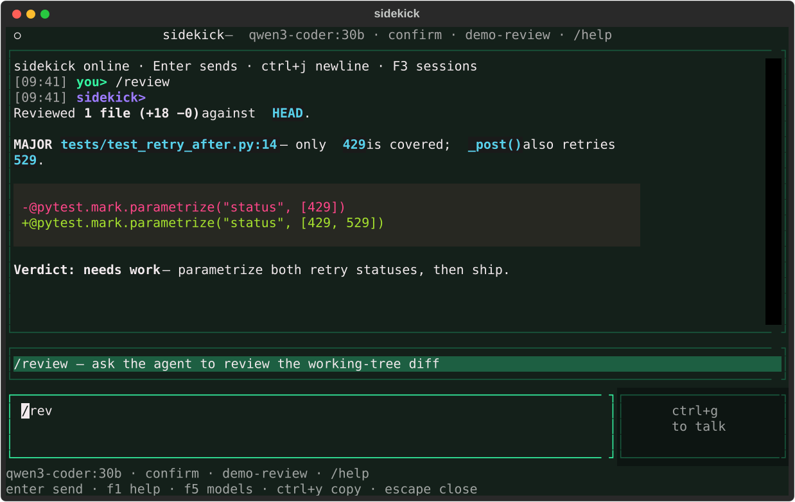
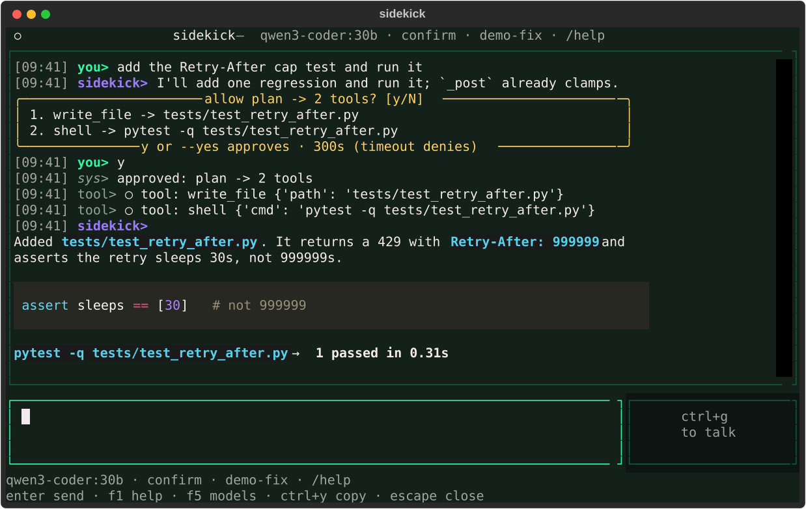
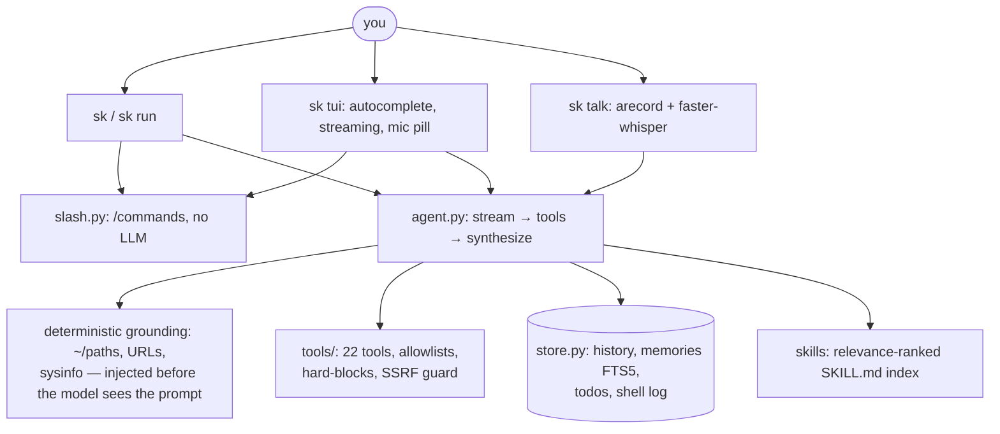

<div align="center">

# Sidekick

**A local-first terminal agent for developers — chat, code, and 22 tools, on your hardware.**

[](https://www.python.org/)
[](https://textual.textualize.io/)
[](https://ollama.com/)
[](LICENSE)
[](https://github.com/Faisal-Fayaz/sidekick/actions/workflows/ci.yml)
[](https://pypi.org/project/sidekick-agent/)
[](https://pepy.tech/projects/sidekick-agent)

*No cloud account required. No API bill by default. Your files, memory, and voice stay on your machine unless you hand it a key.*

```bash
uv tool install "sidekick-agent[voice]" && sk init && sk
```

</div>

## Quickstart

```bash
uv tool install "sidekick-agent[voice]"   # global `sk`, local STT included
sk init                                    # hardware → model → verify → web search
sk                                         # fullscreen chat
```

Requires Python 3.12+. The local path needs Ollama (`ollama serve`). `sk init`
checks your hardware, suggests a model that fits, and verifies the connection.
Any OpenAI-compatible endpoint also works — bring a key or point Sidekick at a
local server.

## See it

**Review the diff before you commit.** `sk review` and `/review` run one
evidence-backed engine: every finding needs a real `file:line` and an exact
evidence quote, or it is dropped. Ten built-in rules cover common security and
correctness footguns, each with a positive/negative fixture; the eight
`security/*` rules are protected from project overrides. Branch and PR reviews
also get an advisory worth-it assessment. `/diff` prints the same diff without a
model call. See [Review](docs/review.md).



**Approve the plan, then verify the result.** Sidekick reads the repo, asks you
to approve the multi-tool plan, writes the test, runs it, and reports the
result. Reads run automatically; writes and shell commands ask first.



*Real headless captures of the shipped TUI from [`docs/shot.py`](docs/shot.py).
The demo sessions are seeded and no model is called; `qwen3-coder:30b` is a
display model, and `sk init` picks one for your hardware. The marketing/docs
site lives at <https://faisal-fayaz.github.io/sidekick/> (source in
[`website/`](website/)).*

## Why Sidekick

Sidekick is a terminal agent that can actually operate your machine: read and
edit code, run commands, search the web only where you allow it, remember
projects, and leave an audit trail you can inspect.

It is built for the cases where a hosted agent is a bad fit: private repos,
regulated code, offline or flaky networks, small GPUs, and developers who want
to see exactly what the agent did.

| | Sidekick | Typical hosted agent |
|---|---|---|
| Runs fully offline with Ollama | ✅ | ❌ |
| Source code stays on your machine by default | ✅ | usually sent to a provider |
| Voice transcribed on your CPU | ✅ | ❌ |
| Answers grounded in *your* system, not guessed | ✅ deterministic grounding | prompt-only |
| Approval gates, hard refusals, and checkpoints | ✅ | varies |
| Deny-by-default egress for model-initiated fetches | ✅ `sk egress`, logged | ❌ |
| Audit ledger with credentials redacted | ✅ `sk audit` | vendor-side logs |
| MCP server and client | ✅ both directions | varies |
| Editable skills, commands, and tools | ✅ `SKILL.md`, `TOOLS.md` | varies |
| Default bill | **$0** | metered |

## Developer workflow

Sidekick is deliberately approval-first. Reads run automatically; writes,
deletes, and general shell commands ask. That makes it useful on a real repo
without handing an unattended model the keys.

| Task | What you use |
|---|---|
| Explore a repo | `list_dir`, `repo_map`, `read_file` (with line ranges), `search_code`, `glob_files`, and the read-only `exec` allowlist |
| Edit safely | `write_file` / `edit_file` with approval; `/plan` to propose; `/rewind` to undo |
| Inspect changes | `/diff`, and `sk review` / `/review` with evidence-backed findings |
| Automate | `sk run --json`, `sk run --bg`, and `sk jobs` |
| Extend | skills, custom slash commands, declarative `TOOLS.md` tools, MCP |
| Stay in control | approval cards, hard refusals, egress allowlist, audit ledger |

The TUI and plain-text REPL share every command, so a scripted fallback and an
interactive session behave the same way.

`search_code` uses `rg` when installed, then `grep`, then a Python walker. It
skips hidden paths, symlinks, binaries, and `.gitignore` matches; results default
to 50 (hard cap 200) and say when they are truncated. `glob_files` returns at
most 200 sorted paths. `repo_map` outlines a directory tree with language
totals, file sizes, and top-level symbols; its default budget is 1,500 tokens
and it reports token, node, and scan truncation. None of these needs approval.

## Chat

One input, two surfaces:

```bash
sk                   # fullscreen TUI with streaming + themes — start here
sk tui --model fast  # same, explicit form
sk chat              # fallback REPL: dumb terminals, screen readers, broken TUIs
```

Type `/` and autocomplete filters all 30+ commands — Enter completes, Tab too,
Esc dismisses, ↑/↓ navigates. `F1` opens a generated cheatsheet built from the
same tables as the dispatcher, so it cannot rot.

TUI keys: **Enter** sends · **ctrl+j**/**alt+enter** newline · **↑/↓** history ·
**ctrl+y** copies · **ctrl+g** push-to-talk · **pgup/pgdn** scroll · **F1** help ·
**F2** dark/light theme · **F3** sessions drawer · **F4** plan/build toggle ·
**F5** model picker.

Answers stream live as Markdown. The status bar shows model, session, mode, and
last-turn stats. Approvals arrive as cards with a timeout.

Plan mode proposes without writing: `/plan` blocks file writes in chat
(`/build` reverts), `F4` toggles the same in the TUI, and `sk run --plan` does it
single-shot. Sessions carry `/compact [hint]`, `/diff`, `/review`, and
`/rewind [n]` to undo agent file edits. `sk review --pr N` can post comments to
GitHub or Bitbucket when credentials are available; it never edits the branch.

## Install

| Channel | Command |
|---|---|
| PyPI / uv | `uv tool install "sidekick-agent[voice]"` |
| PyPI / pipx | `pipx install "sidekick-agent[voice]"` |
| PyPI / pip | `pip install "sidekick-agent[voice]"` |
| AUR (Arch) | `yay -S python-sidekick-agent` |
| conda-forge | `conda install -c conda-forge sidekick-agent` *(separate feedstock repo)* |

The published name is **`sidekick-agent`**; the command stays `sk`. Without
`[voice]` you get everything except Talk/mic, which installs on first use.
Version lives in `src/sk/__init__.py`. Publishing is automatic and
credential-free: merging a version bump to `main` trusted-publishes to PyPI and
opens a GitHub Release. Forks cannot publish. Details:
[`packaging/README.md`](packaging/README.md).

**From source (dev):**

```bash
git clone https://github.com/Faisal-Fayaz/sidekick && cd sidekick
uv tool install -e ".[voice]"
sk doctor
```

## Voice

```bash
sk talk [-d SECS] [--stt-model base] [--device hw:2,0]  # Enter records, Enter stops
sk mic-test                                             # peak dB + verdict
```

Capture uses the OS-native recorder (arecord/ALSA on Linux, sox/ffmpeg on
macOS); transcription uses local faster-whisper int8. The transcript lands
editable in the prompt. In the TUI, `ctrl+g` or the mic pill does the same.
Recordings are temp files and are deleted after each take.

## MCP

```bash
sk mcp [--allow-writes]   # JSON-RPC 2.0 over stdio, zero new deps
```

All 22 tools, same safety policy: SSRF guards, write blocklists, and hard
refusals apply unchanged. Reads auto-run; shell/writes/delete need
`--allow-writes`, otherwise they return a clean denied error. Stdout carries
protocol only.

Claude Desktop snippet:

```json
{ "mcpServers": { "sidekick": { "command": "sk", "args": ["mcp"] } } }
```

Sidekick also works as an MCP client. See [`docs/mcp-client.md`](docs/mcp-client.md).

## Providers

```bash
sk connect   # pick provider → paste key (hidden) → pick model → ping
```

Presets: `ollama | openai | groq | together | deepseek | openrouter | google |
lmstudio | anthropic | opencode | custom`. `anthropic` speaks the native
Messages API; the rest are OpenAI-compatible. Any compatible endpoint works via
`--provider custom --base-url https://... --api-key ...`.

Preferred key handling: `SIDEKICK_API_KEY` in the environment (never touches
disk). File keys are chmod 600 and masked in `--show`. `sk auth
add/list/status/remove` manages credentials; `sk model` asks the provider for
its live list.

Reasoning effort: `sk config --reasoning-effort low` (default;
`off|minimal|low|medium|high|max`), escalated to `high` in plan mode. Honored on
OpenRouter (`reasoning.effort`), OpenAI (`reasoning_effort`), Anthropic
(thinking budget sized to fit `max_tokens`), and Ollama (`think` toggle).

<details>
<summary>OpenCode Zen free tier</summary>

The `opencode` preset points at OpenCode Zen, with free tool-capable models plus
paid tiers. The anonymous free tier is restricted to opencode's own app, so add
a free OpenCode account key first: `OPENCODE_API_KEY` or
`sk auth add opencode` (get it at opencode.ai/auth). Fast/smart resolve to
`nemotron-3.5-lightning-free` / `muse-spark-1.3-contributor-free`; run
`sk models opencode` for the live list.

</details>

## Command reference

### Chat and sessions

| Command | What |
|---|---|
| `sk` / `sk tui [--continue] [--model M] [--allow LIST] [--deny LIST]` | Fullscreen chat, fresh session each launch. `sk --version` prints the version and exits; `--cwd DIR` and `--profile NAME` work on every command |
| `sk chat [--continue] [--session S] [-y\|--yes] [--model M] [--allow LIST] [--deny LIST] [--no-stream]` | Fallback plain-text REPL (dumb terminals, screen readers, TUI issues) |
| `sk talk [-d SECS] [--stt-model base] [--device hw:2,0] [--session S] [-y] [--install]` | Push-to-talk voice chat (CPU transcription; `--install` skips the install prompt) |
| `sk mic-test [-d SECS] [--device hw:2,0]` | Mic level check: peak dB + silent/quiet/good verdict |
| `/sessions`, `/resume <n>`, `/sessions delete <n>`, `/fork [n]` | List, switch, delete, branch past sessions |
| `/yolo`, `/confirm`, `/readonly` | Approval modes: auto-approve writes / ask every time / block all file writes |
| `/compact [hint]`, `/diff`, `/review` | Summarize history on demand / inspect working-tree diff / evidence-backed review |
| `/plan`, `/build` | Plan mode: propose without writing / back to build mode |
| `/rewind [n]` | Undo an agent file edit (snapshots write/edit/delete targets; `shell` mutations are not tracked) |

### Agent and automation

| Command | What |
|---|---|
| `sk run "task" [--yes] [--plan] [--read-only] [--deny LIST] [--model auto\|fast\|smart\|name] [--json] [--bg] [--allow LIST] [--session S] [--no-stream]` | Single-shot agent run. Auto-routes the model; `--json` emits one machine-readable document + exit codes; `--bg` detaches and notifies; `--allow shell:pytest,write_file` skips prompts for listed tools |
| `sk review [--base REF\|--staged\|--commit SHA\|--pr N] [--path P] [--intent TEXT] [--assess\|--no-assess] [--post\|--no-post] [--json\|--sarif] [--fail-on LEVEL] [--explain\|--check-config] [--trust-project-rules] [--disable RULE] [--severity RULE=LEVEL]` | Evidence-backed review of a diff or PR. Findings need file:line evidence; the worth-it assessment is advisory. Policy comes from layered review packs (`~/.sidekick/review.toml`, then a trusted repo pack). `--pr` auto-posts comments to GitHub (via `gh`) or Bitbucket when credentials exist; it never edits the branch |
| `sk jobs [-n N]` | List background jobs from `sk run --bg` |
| `sk brief [-p PATH] [--smart]` | Morning digest: system + git + todos + memories, instant without an LLM |
| `sk digest [--force]` | Brief + overnight failures, desktop nudge or log |
| `sk export [SESSION] [--out f.md] [--force]` | Session transcript as Markdown. Refuses to overwrite unless `--force` |
| `sk imagine "prompt" [--out f.png] [--size WxH] [--model M]` | Generate an image via the provider images endpoint |

### Memory and search

| Command | What |
|---|---|
| `sk remember/recall/memories/forget` | Long-term memory (FTS5 search, auto-injected) |
| `sk search QUERY [--session S]` | Full-text search across past transcripts |
| `sk todo add/list/done/clear` | Todos |
| `sk history` / `sk oops` | Shell log / explain last failure |
| `sk stats [--session S] [--format md\|json]` | Usage + cost estimates from audit rows; pair with spend caps |

### Safety and audit

| Command | What |
|---|---|
| `sk egress [list\|allow HOST\|deny HOST\|test URL]` | Egress policy: what the model may fetch, and what it was blocked from ([docs](docs/egress.md)) |
| `sk audit [--session S] [--format md\|json] [-n N]` | Compliance log: tool runs, approve/deny, local-vs-egress (`-n` clamped 1–1000) |
| `sk hook-install [--write]` | Bash/zsh logging hook |
| `sk hooks [--check]` | List event hooks + live dry-run (see [`docs/hooks.md`](docs/hooks.md)) |

### Extensions and servers

| Command | What |
|---|---|
| `sk skills` / `sk skills-search` / `sk skills-registry [QUERY]` / `sk skills-install NAME` | Skill packs: registry + superpowers |
| `sk plugins` | User-defined tools (`TOOLS.md`, see [`docs/plugins.md`](docs/plugins.md)) |
| `sk mcp [--allow-writes]` | MCP server over stdio (22 tools, safe defaults) |
| `sk mcp-servers` | List configured MCP client servers + live tool check (see [`docs/mcp-client.md`](docs/mcp-client.md)) |
| `sk daemon [--once]` / `sk daemon-install [--schedule TXT]` / `sk daemon-install-macos [--schedule TXT]` / `sk daemon-uninstall` / `sk daemon-schedule [--set TXT]` | Background watcher (systemd/launchd, calendar schedules) |

### Setup and system

| Command | What |
|---|---|
| `sk init` / `sk setup` / `sk connect` | Guided first-run / full setup / provider key flow |
| `sk doctor [--fix]` / `sk report` / `sk upgrade [--check]` | Health (+auto-remediation) / redacted diagnostics bundle / self-update |
| `sk models [list \| pull <id> \| prune <id>]` / `sk model` / `sk config` / `sk version` | Models (list, download, remove) / ask the provider for its live list / settings / build |
| `sk auth add/list/status/remove` | Manage provider keys (masked, validated live) |

Packs use the `SKILL.md` frontmatter format. The prompt carries a relevance-ranked
index; the agent loads full instructions on demand via the `skill` tool.
`fast`/`smart` resolve per provider.

### The `--json` envelope

`sk run --json` prints exactly one JSON document on stdout, and the exit code
reports the outcome:

```json
{"ok": true, "answer": "...", "model": "qwen3-coder:30b", "session": "default", "tools": ["read_file"], "error": null, "error_code": null}
```

`ok` is the outcome of the *turn*, not of the command. A turn that died
mid-flight used to hand back its error text as the answer with `ok: true`, so a
caller could not tell a finished run from a throttled one — a benchmark harness
scored a rate-limited run as a completed turn. `error_code` is a stable
classification so a caller never has to parse prose: `rate_limit`, `auth`,
`server_error`, `timeout`, `network`, `bad_request`, `turn_failed`, `job_failed`.
Exit code 1 means the turn failed, 0 that it completed.

## Architecture



Design bets that paid off: **deterministic grounding beats prompt instructions**
(small models ignore rules but cannot argue with injected facts), **text-JSON
fallback** (coders emit tools as text over the OpenAI endpoint), **FTS5 over
vectors** (zero deps, instant, no embedding server on a 4GB box), **parallel
reads** (approval-gated tools stay serial; independent reads run concurrently
with failures isolated), **capability profiles over hope** (known models declare
their tool protocol; the router reads them instead of paying a probing 400).

## Safety

**Approvals first.** Reads auto-run. Writes, deletes, and general shell need
approval (inline card in the TUI, prompt in the CLI), HOME/`/tmp` only, ≤100KB,
never `~/.ssh`, `~/.gnupg`, `/etc`, `/usr`. Multi-tool turns with destructive
actions get one plan review up front instead of per-tool prompts. `shell`
hard-refuses `rm -rf /`, `mkfs`, `dd` to devices, and fork bombs even with
approval. `read_url`/`web_search` block localhost/private IPs.

**Egress is deny-by-default.** Sidekick will not fetch a destination the model
asked for until you allow that host. `sk init` asks once whether to enable web
search (`html.duckduckgo.com` — one fixed host Sidekick picks, not the model);
everything else stays blocked:

```bash
sk egress                              # what is allowed, and what was blocked
sk egress allow example.com            # allow one host
sk egress allow '*.example.com'        # or a whole domain
sk egress deny example.com             # revoke
sk egress test https://example.com/x   # check a URL without fetching it
```

This covers every destination the *model* can cause a fetch of: `read_url`,
`web_search`, and provider-supplied image URLs. With an empty allowlist, all
three are refused. The allowlist is checked on the initial URL **and on every
redirect hop**, so an allowlisted host cannot redirect the agent somewhere
unlisted. `web_search` itself only requests `html.duckduckgo.com` and returns
result URLs as text — it never fetches a hit, so following one is `read_url`,
which is governed on its own.

Your model API endpoint and the MCP servers you configured are unaffected — you
chose those, they are not something a prompt can talk the agent into adding.
Fetch decisions are written to the ledger with the host and reason, visible via
`sk egress` and `sk audit`.

**The ceiling, stated plainly:** this governs fetches made *through the agent's
tools*. A `shell` command running `curl` is not covered — no string denylist can
be a network boundary. That is why shell still needs approval, and why
[issue #329](https://github.com/Faisal-Fayaz/sidekick/issues/329) (OS-level
sandboxing) is the real answer rather than another pattern list. See
[`docs/egress.md`](docs/egress.md).

**Your data is private to your account.** `~/.sidekick` is `0700` and
everything inside it is `0600` — transcript, shell commands, checkpoints, and the
last 100 prompts. An existing install is tightened the first time you run any
`sk` command. This is a local filesystem control: it does not protect against
root, and it does not stop anything the agent itself can read.

## Tests

```bash
uv run --python 3.12 --with ".[test]" pytest tests -q
```

The suite covers unit, regression, Textual pilot, property, and security tests
with no Ollama needed. The eval harness (`tests/test_eval.py`) locks past quality
bugs into offline regression tests, and a suite-wide fixture guarantees tests
never touch your live `~/.sidekick/`.

CI runs the suite on Python 3.12, 3.13, and 3.14 across Ubuntu and macOS, plus
lint, type-check, build, coverage, and website checks.

## Config

`~/.sidekick/config.toml` holds `provider`, `model`, `base_url`, `api_key`, and
the rest. Data stays home: `history.db`, `skills/`, `nudges.log`,
`input_history`, `tui-errors.log`.

| Env var | Effect |
|---|---|
| `SIDEKICK_PROVIDER` / `SIDEKICK_MODEL` | override the configured provider/model |
| `SIDEKICK_BASE_URL` / `SIDEKICK_API_KEY` | override the endpoint / key for this process |
| `SIDEKICK_SPEND_CAP` | per-session USD cap, `0` = unlimited |
| `SIDEKICK_REASONING_EFFORT` | reasoning effort for backends that support it |
| `SIDEKICK_VERIFY_REPAIRS` | post-edit verify repair rounds (default `2`, `0` disables) |
| `SIDEKICK_PROFILE` | load a named config profile |
| `OPENCODE_API_KEY` | key for the `opencode` provider |
| `SIDEKICK_TRUST_REPO=1` | **opt in to repo-supplied slash commands and review rules** |

> **`SIDEKICK_TRUST_REPO` — why your repo's commands and review rules do nothing.**
> A cloned repo can ship `.sidekick/commands/*.md`, and a `!`cmd`` expansion
> inside one reaches `sh -c` with no approval prompt. Review is the same shape:
> `.sidekick/review.toml` can change severities, budgets, and rule guidance.
> Both are ignored unless you set `SIDEKICK_TRUST_REPO=1` in your own shell (or
> pass `--trust-project-rules` to `sk review`). The flag is read from the
> environment and never from repo config, so a repository cannot self-authorize
> (#287). Commands in `~/.sidekick/commands/` and the review pack in
> `~/.sidekick/review.toml` always load. See [Review](docs/review.md#review-pack).

**History budget:** the prompt budget bounds the whole assembled prompt — system
prompt, auto-context, tool schemas, and the reply reservation — then history gets
what is left (#308). `history_budget_tokens` (default 3000) caps that share;
over-budget sessions compact to a rolling summary via the current model (DB
history stays complete). Lower it for small-context models.

**Context window:** `context_window` (0 = take it from the model profile) sets
the total window, and the same number is sent to Ollama as `num_ctx`, so the
budget and the server cannot disagree. Local models default to 16k, frontier to
200k. The fixed cost alone — system prompt plus tool schemas — measures ~3,700
tokens, so a window below ~8k leaves no usable conversation. Raise it if you
have VRAM to spare; the KV cache grows with it. Run `/context` to see where a
turn's tokens go.

**Per-project config:** a `.sidekick.toml` in any repo layers over the global
file (nearest one walking up from cwd). It may carry a `[project]` table only:

```toml
[project]
docs = ["CONTRIBUTING.md", "docs/egress.md"]  # injected into the prompt
memory_namespace = "my-repo"                        # scopes this repo's memory
```

**Nothing at the top level of a project file is honoured** — not `provider`,
`model`, `max_steps`, `temperature`, `egress_allow`, or anything else. A repo
you just cloned must not be able to steer the agent's model, budget, approvals,
or network. Those keys live in `~/.sidekick/config.toml` or the environment
only. The same applies to `[project].approved_commands` (shell approvals stay
global). Every ignored key is reported rather than dropped quietly.

`sk --cwd PATH` runs any command as if in that directory.

**Project memory auto-discovery:** from the cwd upward, the first `SIDEKICK.md`
/ `AGENTS.md` / `CLAUDE.md` / `GEMINI.md` found (root-down) is injected into the
prompt automatically.

**Config profiles:** named `~/.sidekick/profiles/<name>.toml` files replace
`config.toml` when selected via `sk --profile NAME …` or
`SIDEKICK_PROFILE=NAME` (env still wins, project files still layer). Manage with
`sk config --profiles` (list) and `sk config --save-profile NAME` (snapshot
current non-secret settings — keys stay in keyring/env).

## Documentation

- [Egress policy](docs/egress.md)
- [Review](docs/review.md)
- [Event hooks](docs/hooks.md)
- [MCP client](docs/mcp-client.md)
- [Plugins and declarative tools](docs/plugins.md)

## Roadmap

See [`ROADMAP.md`](ROADMAP.md) — the shared plan (vision, next milestone, done
list). It changes by pull request only. Contributions are welcome; see
[`CONTRIBUTING.md`](CONTRIBUTING.md).

## License

MIT — do what you want, shout-outs appreciated.
